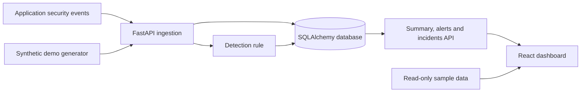

# Tracepoint

**Security Monitoring & Threat Analysis** — *Every event tells a story.*

Tracepoint is an open-source security event monitoring and incident investigation project, built with Python/FastAPI, SQLAlchemy/PostgreSQL and React/TypeScript. It is under active development and **not production-ready**.

**[Live dashboard preview](https://tracepoint-beryl.vercel.app)** · **[Contribute](CONTRIBUTING.md)** · **[Architecture](docs/ARCHITECTURE.md)** · **[Roadmap](docs/ROADMAP.md)** · **[Security](SECURITY.md)** · **[Issues](https://github.com/karisajoshua/tracepoint/issues)

## What works today

- Authenticated event ingestion with idempotency and a basic failed-login detection rule
- Event and alert summaries, hourly activity and investigation endpoints
- Persistent incident cases with status, ownership, notes and change history
- Responsive dashboard with event chart, severity filters and investigation details
- **Read-only sample-data preview** for contributors and visitors (synthetic data only)
- Automated Python tests and dashboard build checks

## Local development

Requirements: Python 3.12+ and Node.js 20+.

```bash
python -m venv .venv
source .venv/bin/activate
pip install -e '.[dev]'
export TRACEPOINT_API_KEY='local-development-secret'
uvicorn tracepoint.main:app --reload
```

Then in a second terminal:

```bash
cd dashboard
npm install
npm run dev
```

The dashboard's **Explore sample dashboard** option works without an API connection. The Vite dev proxy forwards `/api` to `localhost:8000`. On Windows, activate the virtual environment using `.venv\\Scripts\\activate` and set environment variables with your shell.

For a local demonstration with synthetic events:

```bash
python scripts/demo_events.py
```

The generator accepts only a local API URL. Use `TRACEPOINT_DATABASE_URL` for a PostgreSQL connection; otherwise the backend uses a local SQLite database for development.

## API endpoints

- `GET /health`
- `POST /api/v1/events`
- `GET /api/v1/summary`
- `GET /api/v1/activity`
- `GET /api/v1/events`, `GET /api/v1/alerts`
- `GET/POST /api/v1/incidents`
- `GET/PATCH /api/v1/incidents/{id}`
- `POST /api/v1/incidents/{id}/notes`
- `GET /api/v1/incidents/{id}/audit`

All `/api/v1` endpoints currently use a shared `X-API-Key` development credential. This is **not suitable as a production browser authentication design**.

## Roadmap

See the [prioritized engineering roadmap](docs/ROADMAP.md), including current limitations and suggested contribution areas.

## Contributing

For design decisions, see the [architecture](docs/ARCHITECTURE.md) and [ADR convention](docs/adr/0001-contribution-and-architecture-decisions.md). For vulnerability disclosure, see [SECURITY.md](SECURITY.md).

Contributions, bug reports, design improvements, documentation and tests are welcome. Read **[CONTRIBUTING.md](CONTRIBUTING.md)** before submitting a pull request. Please report security vulnerabilities privately rather than opening a public issue.

## Security and data privacy

Never send production credentials, personal information, payment data, or customer security events to the public demo. The dashboard preview uses **synthetic data only**. Barakaz is not connected to Tracepoint.

## Architecture at a glance



The Vite dashboard and Python API are separate applications. The public preview is intended for synthetic data; its production backend connection and secure analyst authentication are **not complete**. The Supabase project exists, but a verified production database connection is not yet established.

## Repository layout

| Path | Responsibility |
| --- | --- |
| `src/tracepoint/main.py` | FastAPI routes, event validation, API-key guard |
| `src/tracepoint/storage.py` | SQLAlchemy models, persistence, detection and incident queries |
| `dashboard/src/App.tsx` | React dashboard and investigation UI (currently being modularized) |
| `dashboard/src/style.css` | Responsive dashboard styles |
| `scripts/demo_events.py` | Local-only synthetic event generator |
| `tests/` | Python API tests |
| `.github/workflows/` | Python and dashboard CI |
| `docs/` | Integration documentation |

## Example event

With the backend running locally and `TRACEPOINT_API_KEY` set in your shell:

```bash
curl -X POST http://127.0.0.1:8000/api/v1/events \
  -H "Content-Type: application/json" \
  -H "X-API-Key: $TRACEPOINT_API_KEY" \
  -d '{
    "event_id": "123e4567-e89b-42d3-a456-426614174000",
    "source": "demo-app",
    "event_type": "auth.login_failed",
    "timestamp": "2026-10-14T12:00:00Z",
    "actor_id": "demo-user",
    "source_ip": "192.0.2.10"
  }'
```

The example address belongs to the reserved documentation range. Use a new UUID for each new event. Ten qualifying failed-login events from one IP within two minutes can generate a high-severity alert. The `scripts/demo_events.py` utility is easier for a local demonstration.

## Test your changes

```bash
pytest -q
cd dashboard
npm install
npm run build
```

Open a focused pull request and describe the tests you ran. For visual changes, attach screenshots. Both Python tests and dashboard builds run in GitHub Actions.

## Configuration reference

| Variable | Where | Purpose |
| --- | --- | --- |
| `TRACEPOINT_API_KEY` | Backend only | Shared development API credential |
| `TRACEPOINT_DATABASE_URL` | Backend only | SQLAlchemy database URL; local SQLite used if unset |

Never commit secrets, expose the ingestion key in frontend code, or submit real customer data to the public preview. A Supabase connection URL must use the correct SQLAlchemy driver and match the deployed schema.

**Database compatibility warning:** The initial Supabase schema and current SQLAlchemy models have not yet been reconciled and validated together. Do not point the deployed API at the Supabase project until migrations and integration tests are complete.

## License status

**No open-source license has been selected yet.** Public source visibility does not automatically grant permission to reuse, redistribute or modify the code. A license (Apache-2.0 or MIT are possible options) must be approved and added before promoting the repository as licensed open source.

## Community links

- [Contribution guide](CONTRIBUTING.md)
- [Open issues](https://github.com/karisajoshua/tracepoint/issues)
- [Feature request template](.github/ISSUE_TEMPLATE/feature_request.md)
- [Bug report template](.github/ISSUE_TEMPLATE/bug_report.md)
- [Pull request template](.github/pull_request_template.md)
