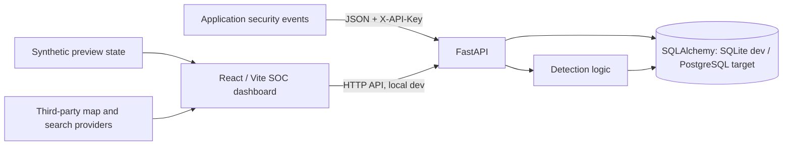

# Tracepoint Architecture

> Status: evolving design; not a production security boundary.

## System context

## Components and responsibilities

| Component | Location | Responsibility |
| --- | --- | --- |
| API | `src/tracepoint/main.py` | Request validation, API-key checks, HTTP routes |
| Storage and detection | `src/tracepoint/storage.py` | SQLAlchemy persistence, simple detection and investigation queries |
| Dashboard | `dashboard/src/App.tsx` | SOC interface, event summaries and investigation controls |
| 2D map | `dashboard/src/WorldMap.tsx` | Leaflet, OpenStreetMap tiles and place search |
| 3D map | `dashboard/src/Map3D.tsx` | MapLibre vector map and building extrusion where data permits |
| Synthetic generator | `scripts/demo_events.py` | Local-only event simulation |
| Tests | `tests/` | Python API behavior |

## Rust processing direction

The Rust crate at `rust/tracepoint-events` is an independently testable normalization library. It is not currently called by FastAPI, and has no database or network access. Cross-language contract tests and benchmarks must precede any production integration. See [Rust development](../rust/README.md).

## Trust boundaries

1. **Untrusted event producers → API:** validate schema, enforce ingestion authorization, and prevent unbounded payloads. The current shared API key is a development mechanism only.
2. **API → database:** use parameterized ORM queries and least-privileged database credentials. The production migration and permission model is not yet finalized.
3. **Browser → API:** a public browser cannot safely hold a shared ingestion secret. Analyst identity, sessions, RBAC, and scoped read/write access are required before production use.
4. **Browser → map services:** map tiles, scripts, and place searches contact external services. Treat them as independent dependencies and do not transmit sensitive event content.
5. **Demo → live:** synthetic locations and alerts must never be represented as observed threats.

## Data flow

An event is accepted by FastAPI, persisted through SQLAlchemy, evaluated by the initial failed-login detection rule, and exposed through summary, alert, and incident endpoints. In development, Vite proxies API requests to FastAPI. The public Vercel frontend does not yet have a verified secure production backend integration.

## Engineering debt (intentional and tracked)

- Extract frontend pages, widgets, and state from the monolithic `App.tsx`.
- Version the database schema with migrations and reconcile Supabase with SQLAlchemy.
- Replace shared analyst API-key access with session authentication and role-based authorization.
- Introduce explicit ingestion contracts, rate limits, bounded queues, observability, and event retention.
- Add frontend component tests and end-to-end integration tests.
- Introduce production-safe geolocation enrichment with privacy controls.
- Pin, review, and where appropriate self-host external map dependencies.

## Architecture decision records

Use `docs/adr/0001-contribution-and-architecture-decisions.md` as the starting template for significant changes. Discuss security-sensitive or cross-cutting decisions in an issue before implementation.
